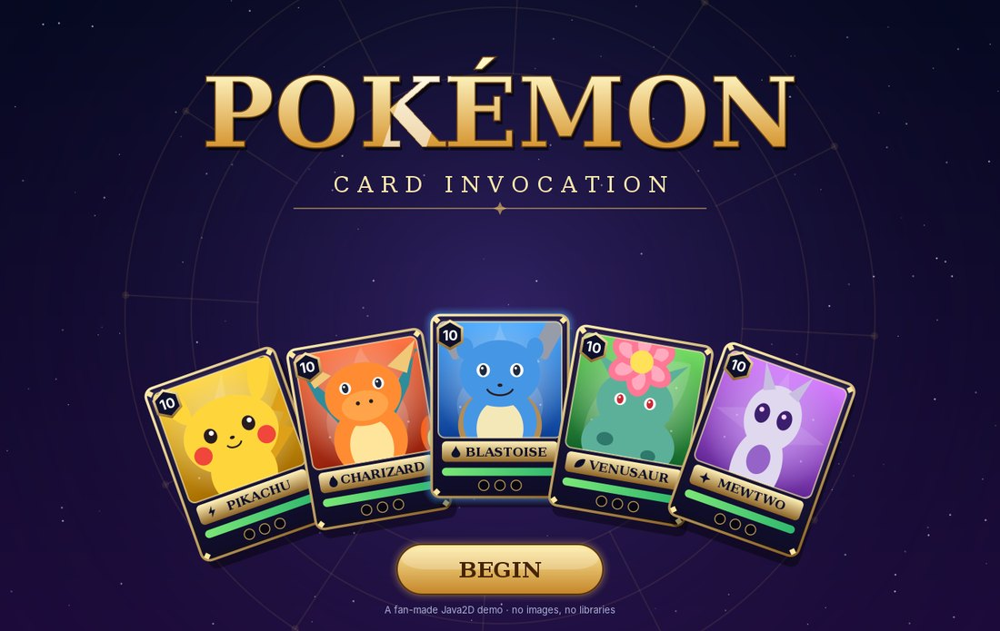
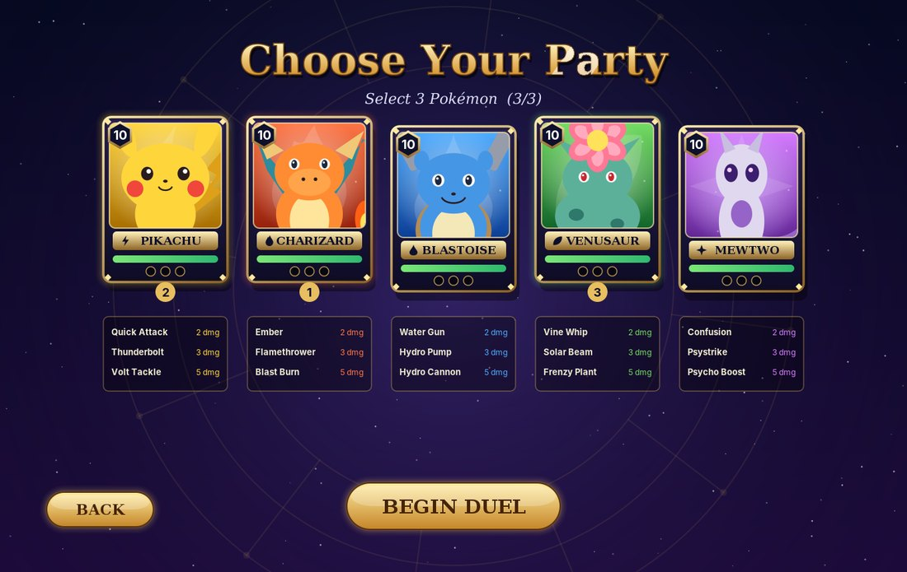
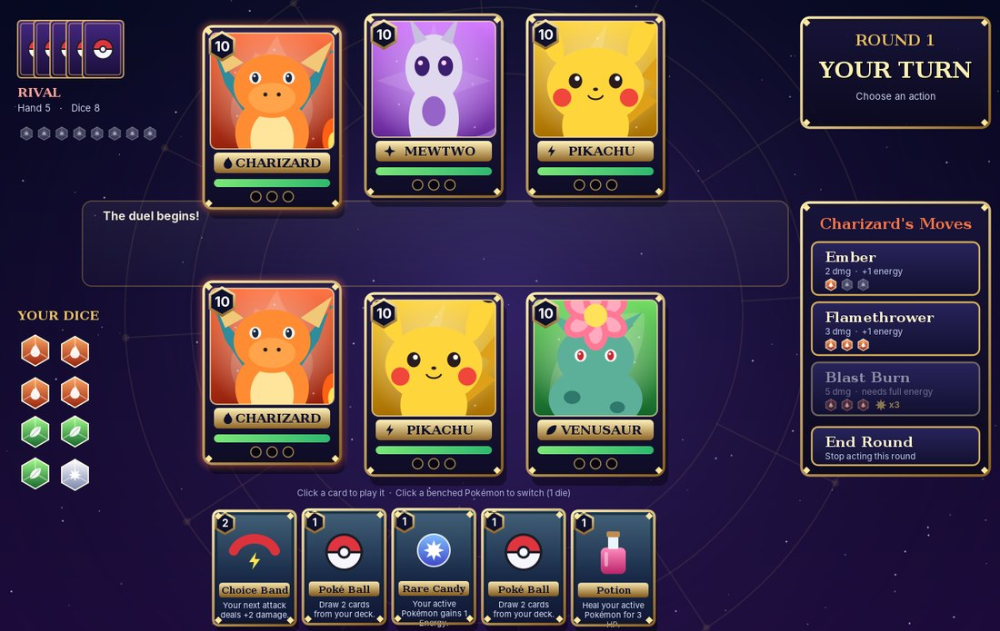
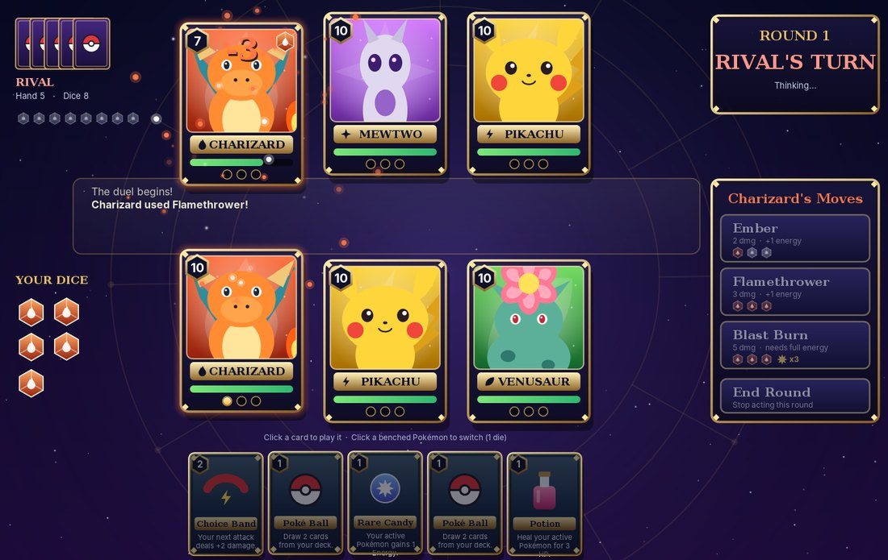

# Pokémon Card Duel

A two-player card battle game written in Java. The player picks 3 Pokémon, rolls dice, and fights a computer rival by attacking, playing support cards and switching Pokémon. The first side to make all 3 enemy Pokémon faint wins.

The game is drawn entirely with code. It uses no image files and no outside libraries.



## Features

- Turn-based battles with 3 Pokémon per side
- Elemental dice that are rolled every round and spent on moves, cards and switching
- 5 Pokémon, each with 3 moves (Pikachu, Charizard, Blastoise, Venusaur, Mewtwo)
- Elemental reactions that add bonus damage when different elements meet
- 4 support cards: Potion, Rare Candy, Choice Band and Poké Ball
- A computer rival that follows the same rules as the player
- Animated cards, sparks, floating damage numbers and screen shake
- A board that fits any window size

## Screenshots

| Choose a team | Battle begins |
|---|---|
|  |  |



## Requirements

- JDK 17 or newer

To check the installed version, run `java -version`.

## Run the game

From the folder that contains `PokemonCardDuel.java`:

```
java PokemonCardDuel.java
```

Or compile first and then run:

```
javac PokemonCardDuel.java
java PokemonCardDuel
```

## Quick guide

1. Click **BEGIN** and pick 3 Pokémon.
2. Click **BEGIN DUEL**.
3. Use the move buttons on the right to attack. Each move costs dice.
4. Click a card in the hand to play it, or click a Pokémon on the bench to switch.
5. Click **End Round** when done acting. A new round starts when both sides have finished.

The full rules are in [How to Play](docs/HOW_TO_PLAY.md).

## Documentation

| Document | What it contains |
|---|---|
| [How to Play](docs/HOW_TO_PLAY.md) | Rules, moves, dice, reactions, cards and controls |
| [Modules](docs/MODULES.md) | The 8 sections of the code and what each one does |
| [Architecture](docs/ARCHITECTURE.md) | The main loop, drawing, clicks and how a turn works |
| [Technical Overview](docs/TECHNICAL_OVERVIEW.md) | The technologies and Java features used |

## Project structure

```
PokemonCardDuel/
├── PokemonCardDuel.java
├── README.md
└── docs/
    ├── HOW_TO_PLAY.md
    ├── MODULES.md
    ├── ARCHITECTURE.md
    ├── TECHNICAL_OVERVIEW.md
    └── img/
```

## Notes

This is a fan-made project made for learning. It is not affiliated with or endorsed by Nintendo, Game Freak or The Pokémon Company. Pokémon and its character names belong to their owners. The card duel style is inspired by the Genius Invokation card game in Genshin Impact.
