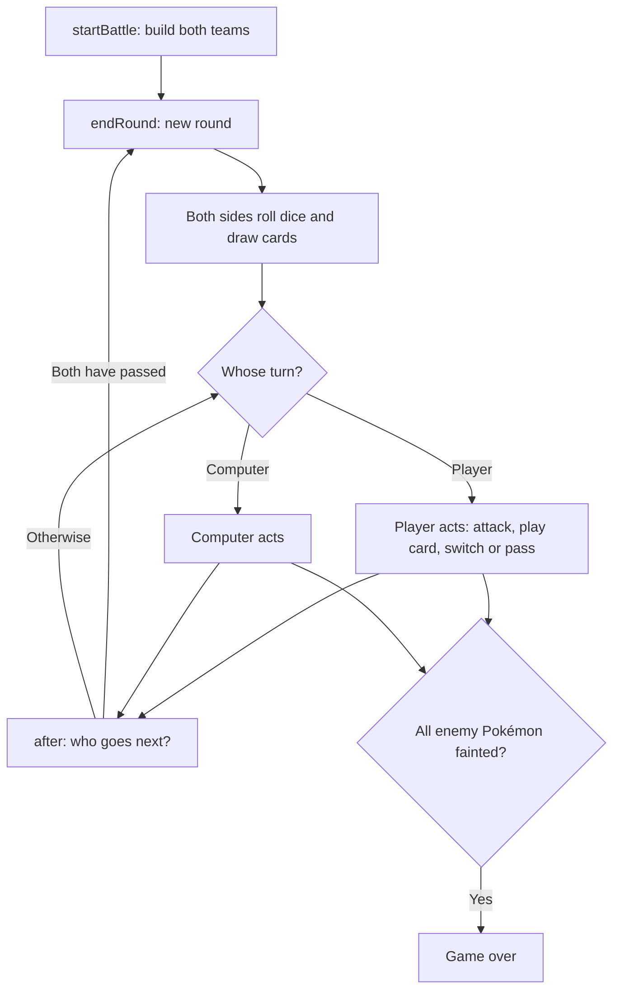

# Architecture

This page describes how the game runs: the main loop, how the screen is drawn, how clicks work, how a turn is played, and how the game ends. Terms like dice, energy and aura are explained in `MODULES.md` and `HOW_TO_PLAY.md`.

## The big picture

The game is a single Java window made with Swing, Java's built-in toolkit for windows. Everything on screen is drawn with code, and no image files are used. The program does the same three jobs over and over, many times a second:

1. Update the game (move sparks, fade text, let the computer play).
2. Draw the current screen.
3. Wait for the mouse.

## The main loop

A timer goes off every 16 milliseconds, about 60 times a second. Each time, a method called `tick()` runs.

```
Timer (every 16 ms)
      |
      v
   tick()  -->  move sparks and floating numbers
      |         update HP bars and hover glow
      |         let the computer play, if it is its turn
      v
  repaint()
      |
      v
paintComponent()  -->  draw background, current screen, effects
```

The computer only plays when all of these are true:

- the battle screen is showing
- nobody has won yet
- it is the computer's turn
- the round banner has mostly faded
- its waiting time is over

The waiting time is there so the computer does not answer instantly. It gives the player time to see what happened. Short waits are set after each action (roughly one second), and a longer one at the start of a round.

## Drawing the screen

The whole screen is redrawn from scratch on every frame. Nothing is saved from the previous frame. The `paintComponent` method does this in order:

1. Fit the board to the window (see "Fitting any window size" below).
2. Clear the list of clickable areas.
3. Add a small random shake if something was just hit.
4. Draw the night sky background.
5. Draw the current screen: title, team select or battle.
6. Draw the effects on top: sparks, floating numbers and the round banner.

The game has three screens: title, team select and battle. A setting called `scr` remembers which one is showing, and the game draws the matching one (`title`, `select` or `battle`).

## Clicks and buttons

Buttons and cards are not stored anywhere permanently. Each time a button is drawn, it also adds an entry to a list called `hits`. Each entry holds three things:

- a name (for example `"pass"`)
- a rectangle on the screen
- the action to run when that rectangle is clicked

Because the list is cleared and rebuilt on every frame, it always matches what is on screen. A button that is not drawn cannot be clicked.

When the mouse moves, the game looks through the list to find which rectangle is under the pointer, and remembers its name. This is how buttons glow and how the cursor turns into a hand. When the mouse is pressed, the same search is done and the matching action is run. The list is checked from the last entry to the first, so whatever was drawn last (the item on top) wins.

## How a turn works

A match is made of rounds. In each round both players roll dice and draw cards, then take turns doing actions until both have passed. "Pass" means a player stops acting for the rest of the round.



The main steps:

- **`startBattle`** builds the player's team from the picks and gives the computer a random team of 3.
- **`endRound`** adds 1 to the round number, rolls 8 dice for each side, deals cards (5 in round 1, 2 after that) and decides who goes first. In round 1 the player goes first. After that, whoever passed first in the previous round goes first.
- **`act`**, **`swap`** and **`pass`** each call `after`, which decides what happens next.
- **`after`** starts a new round if both sides have passed. Otherwise it gives the turn to the other side. If the other side has already passed, the same side keeps going.
- **`play`** (playing a support card) is the one action that does not call `after`. The same side keeps its turn after playing a card.

## The computer's turn

The computer follows the same rules as the player. It pays for moves with its own dice and plays its own cards. The `ai` method only decides what to do, using a fixed list of checks (heal if low, use a card if useful, attack with the strongest move it can afford, otherwise pass). The full list is in `MODULES.md`.

The computer does not run on its own in the background. `tick()` simply asks it to play when its waiting time is over.

## Ending the game

When a Pokémon's HP reaches 0, the `hurt` method marks it as fainted. If it was the active Pokémon, the next living one is sent out automatically. If a side has no living Pokémon left, the other side is recorded as the winner.

Once there is a winner:

- the computer stops acting
- the battle screen shows a dark overlay with VICTORY or DEFEAT
- the PLAY AGAIN button goes back to team select

## Fitting any window size

The board has a fixed size of 1360 by 860 points, and every position in the code uses these points. When drawing, the game works out how much to shrink or stretch the board, and where to place it, so it fits the window and stays centred. If the window has a different shape, black bars fill the gap.

Mouse clicks need the opposite step. The `loc` method converts a position in the window back to a position on the board, so clicks land in the right place at any window size.

## Keeping the rules and the looks apart

The code is arranged so the game rules can be read without any drawing code mixed in:

- **Game rules** only change the game's numbers: HP, dice, cards and whose turn it is.
- **Screens and cards** only read those numbers and draw them.

There is one small link between the two. When something happens, such as a hit, the rules ask for sparks and floating numbers (`burst` and `floatTxt`). These only change how the game looks, never who wins.

The timer, the mouse clicks and the drawing all happen one after another, never at the same time. Because of this, no part of the code can change the game's numbers while another part is reading them, so no extra protection is needed.
